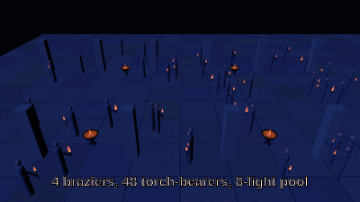
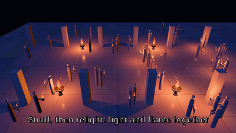

# bevy_lights

Practical lights for Bevy 0.20: fires that flicker and flare as they kindle, a budgeted pool of real
lights placed over thousands of virtual ones, and billboard shader flames.

[](https://github.com/Ladvien/bevy_lights/actions/workflows/ci.yml)

> ⚠️ **Vibe Coded**
>
> This crate was written with heavy LLM assistance, under human direction and review. Every model is
> researched and every default is cited or marked a design default; the code is tested, gated in CI
> and reviewed against captures. It is still code an agent wrote, and you should treat it as such.



*Two seconds of `examples/courtyard`, 400 × 225 at 30 fps: four braziers — real lights, each with a
`Kindle` and a 0.34 m coal bed, which the puffing law sizes to `1.5/√0.34 ≈ 2.57 Hz` — and 48
torch-bearers, each a `PoolCandidate`, sharing the example's eight pooled real lights, of which the three best-ranked cast shadows (`LightPool::max_shadowed`); every figure throws a shadow from the braziers and from those three. Each brazier also throws `FlameEmbers` (`LIGHTS_EMBERS=4` in the capture, the example's default is off). The clip opens
while the courtyard is still lighting up and the fires breathe from there; the coals are the
`char_field` texture the example builds at startup. The opening cannot show a **flame** catching: a
flame's catch runs on `Time<Real>`, and on a headless capture the material's first pipeline compile
outlasts `KINDLE_SECONDS`. A *re*-light does not have that problem, so the catch is the next clip.
[`docs/DEMOS.md`](docs/DEMOS.md) has that trap and the frequencies measured in this file. The same
courtyard at 640 × 360 is [`courtyard.gif`](docs/media/courtyard.gif).



*`LIGHTS_SNUFF=1.0 LIGHTS_RELIGHT=2.3` on the same courtyard, 400 × 225 at 30 fps, 64 frames (about 2.1 s): every
brazier and torch is snuffed (`Snuff`, 1.2 s) so the stone falls to the cool moonlight with only the coals glowing,
then re-lit (`Kindle`), and each flame grows out of its coals as its light flares up; sparks are `FlameEmbers`.

## What you get

- **Flickering, kindling fires** (`FlickerPlugin`): a point or spot light modulated below its base by a
  summed sine, at a rate its fuel bed sets and a depth the host chooses, plus a `Kindle` that flares a
  fire up over 0.6 s and a `Kindled` message for the sound of it, and a `Snuff` that puts one out over 1.2 s
  (light and linked flame together) with a `Snuffed` message for the hiss; both work on a pooled torch too, via its `PoolCandidate`,
  and a pooled fire that stays out costs the pool less than one that is lit, however many there are.
- **A budgeted pool of real lights** (`LightPoolPlugin::<YourFocusMarker>`): a fixed number of real
  point lights handed to the best-ranked candidates around the entity carrying your focus marker (or, with
  `FocusRule::Shared`, one per viewer, as in split-screen co-op),
  with hysteresis, a cross-fade and a per-frame hand-off budget, so a light that changes owner does not
  pop — and a shadow budget, so only the nearest few cast shadows and a shadow that moves fades rather
  than pops.
- **Flames drawn where the fire is** (`FlamePlugin`): one additive billboard material and one draw per
  flame, each breathing on the same curve as the light it motivates — and at that light's own rate,
  phase and depth when the site is given them, and catching again or going out when its light is re-lit or snuffed (`FlameSite::fire`).
- **The maths as plain functions** (`bevy_lights::model`): the flicker law and its depth, the kindle,
  the pool's hold-and-fade rules, the cinematographer's key against fill, the blackbody, and the
  temperature field of a fuel bed — no `bevy` in any of them, so a host can reuse them in its own
  systems.

## Install

`0.3` is on crates.io:

```toml
[dependencies]
bevy_lights = "0.3"
```

Everything this README describes is in that release. `main` may be ahead of it (`CHANGELOG.md`'s
`Unreleased`); depend on the branch if you want that:

```toml
[dependencies]
bevy_lights = { git = "https://github.com/Ladvien/bevy_lights", branch = "main" }
```

The crate is pinned to Bevy 0.20; its MSRV is Rust 1.97.1. `serde` is an optional feature: it derives
`serde` on the components and resources a host saves — `Flicker`, `Kindle`, `Snuff`, `PoolCandidate`, `PoolLight`,
`FlameSite`, `FlameLook`, `Rank`, `LightPool` — and turns on Bevy's own `serialize` for the colours they carry.
`PointLight` has no serde derive, so `LightPool` saves its slot template as the fields the pool copies onto
its lights — all of them but `intensity` — and every field is optional on the way in.

## Quick start

```rust
use bevy::prelude::*;
use bevy_lights::*;

/// The one thing the pool measures distance from: your camera focus, your player, a squad.
#[derive(Component)]
struct MyFocus;

fn main() {
    App::new()
        .add_plugins(DefaultPlugins)
        .add_plugins((
            FlickerPlugin,
            LightPoolPlugin::<MyFocus>::default(),
            FlamePlugin,
        ))
        .add_systems(Startup, setup)
        .run();
}

fn setup(mut commands: Commands) {
    // A brazier: a real light, sized by the pool it lights (1000 lx at 4 m, from 0.9 m up) and
    // coloured by the temperature it burns at.
    let lumens = fire_lumens(1000.0, 4.0, 0.9);
    let [r, g, b] = blackbody_colour(1900.0, 1.0);
    commands.spawn((
        PointLight { color: LinearRgba::rgb(r, g, b).into(), intensity: lumens, range: 10.0, ..default() },
        // `diameter` sizes the flicker by the fuel bed (`f = 1.5/√D` Hz); `None` uses the un-sized rate.
        Flicker { phase: 0.0, diameter: Some(0.34), ..Flicker::at_mean(lumens, FLICKER_DEPTH) },
        Kindle::default(),
        // `kindle` grows the flame with its light, on the same 0.6 s envelope, and `diameter` matches
        // the `Flicker`'s so the drawn flame breathes at the same rate the light does. `depth` is how
        // far it dips: give the flame the same one as its light, or the two disagree.
        FlameSite { height: 1.1, phase: 0.0, kindle: KINDLE_SECONDS, diameter: Some(0.34), depth: FLICKER_DEPTH, depth_fade: false, fire: None },
    ));

    // A torch-bearer: a virtual light, which gets one of the pool's real lights when it is near. A
    // hand-held flame is smaller, so its pool is sized from its edge.
    //
    // One entity holds both the flame and the candidate, so the light it is handed can never drift away
    // from the fire: `offset` is the flame's own centre (`flame_light_offset`), measured from the site's
    // origin, and the intensity is sized for the height the light will actually sit at.
    let torch_height = 0.35;
    commands.spawn((
        // `phase` is this torch's own fire clock: the real light it is handed later breathes with the
        // flame drawn on it, not with the pool slot that happens to own it.
        PoolCandidate {
            offset: Vec3::from(flame_light_offset(torch_height)),
            intensity: fire_lumens(250.0, 2.0, flame_light_offset(torch_height)[1]),
            phase: Some(1.9),
            ..default()
        },
        // The pool's lights flicker at the un-sized rate, so this flame does too.
        FlameSite { height: torch_height, phase: 1.9, kindle: 0.0, diameter: None, depth: FLICKER_DEPTH, depth_fade: false, fire: None },
        Transform::from_xyz(4.0, 0.0, 2.0),
    ));

    commands.spawn((MyFocus, Transform::default()));

    // The fill: what the fires read against. The crate does not own the moon — a host adds the light and
    // asks the crate for the illuminance that makes the ratio it wants.
    commands.spawn(night_fill());
}

/// The night's fill: two stops under the fire. The crate does not own the moon, so the host adds it
/// and asks the crate for the illuminance.
fn night_fill() -> DirectionalLight {
    let [r, g, b] = white_balanced(8000.0, 2856.0, 1.0);
    DirectionalLight {
        color: LinearRgba::rgb(r, g, b).into(),
        illuminance: fill_for(1000.0, MOON_KEY),
        ..default()
    }
}
```

A light you want to be able to *re-light* is re-inserted with `Kindle::default()`, which writes
`Kindled` again. A fire you want dimmer or brighter is changed through the `Flicker` (`set_mean`, never the light's
`intensity`: the crate writes the intensity every frame).

`examples/courtyard.rs` is the full showcase, `examples/bench_lights.rs` the CPU bench for the pool and the flicker, and `examples/bench_flames.rs` the bench for thousands of flames with few of them on screen (it renders off-screen and needs a GPU adapter).

## Features

### Fires: flicker, depth and kindle

Every `PointLight` and `SpotLight` carrying `Flicker` is modulated **below** its base intensity by a
summed sine: the multiplier runs `1 - 2·depth ..= 1`, so `Flicker::base` is the fire's brightest moment
and a deeper flicker is a darker trough rather than a brighter crest. At the default `Flicker::depth`
of `FLICKER_DEPTH` that is 0.70–1.00 of base with a mean of 0.85 — the window a lumen budget written
against the mean assumes. `Flicker::depth` is how far that fire dips, so a lantern can ask for 0.03 and
a gusting torch for 0.3; `flicker_depth` clamps the value to `0..=MAX_FLICKER_DEPTH` (0.5, the deepest
whose trough is still zero) and reads a `NaN` as the default. `CALM_FLICKER_DEPTH` (0.05) and `WHIPPING_FLICKER_DEPTH` (0.3) name the two ends, and `flicker_mean(depth)` is the multiplier's mean, so a budget is written with `Flicker::at_mean(lumens, depth)` (or `PoolCandidate::at_mean`) rather than a hand-divided `0.85`. A system that rewrites a light's lumens every frame calls `Flicker::set_mean`, and a fire that changes how it breathes calls `Flicker::set_depth`, which keeps the mean: a deeper depth never silently dims the fire.

Give a fire its fuel-bed size (`Flicker { diameter: Some(0.34) }`) and its flicker runs at the measured
puffing rate, `1.5/√D` Hz — a brazier at 2.6 Hz, a pyre at 0.75 — so a large fire breathes more slowly
than a small one. `diameter: None` is the crate's inherited un-sized rate, for a fire whose size is not
modelled.

**Fire kinds.** `FireKind::{Candle, Lantern, Torch, Brazier, Campfire, Bonfire}` (`FireKind::ALL`, serde as the name) bundles a fuel-bed diameter, a flicker depth and a flame height, so a picker or a project file stores one word: `FireKind::Torch.flicker(lumens)` is a `Flicker` averaging `lumens` and `FireKind::Torch.site()` a `FlameSite`, built from the same three numbers so the light and its flame breathe together (spell the rest with `..`: `FlameSite { phase: 1.3, ..FireKind::Torch.site() }`). `rate()` is the puffing law at that size, 13 Hz for a candle to 0.87 Hz for a bonfire. Only the brazier row is a number the crate shipped before; the rest are design defaults (`docs/research/fire-kinds.md`). `LIGHTS_KIND=<name>` dresses the courtyard's braziers as a kind. `FireKind::reach()` is the metres of ground a kind lights to its pool's edge (1 m for a candle to 9 m for a bonfire), and `FireKind::light(lux, over)` is the `Flicker` whose lumens put `lux` there, so a picker places a fire without typing a lumen number; the brazier's 4 m and the torch's 2 m are the courtyard's own pools, the rest design defaults (`docs/research/fire-reach.md`).

A light with `Kindle` flares up over `KINDLE_SECONDS` (0.6 s) instead of switching on, on
`kindle_gain`'s curve: a smoothstep with a flare running ahead of it, so it is 0.85 of the way at half
time, tips nine tenths of one percent above its base at about 0.46 s, and settles at exactly 1.
`Kindled { entity }` is the message a host hears on the frame a fire catches, for the sound of it. An
invisible light is not rewritten (nothing is extracted for it) but its kindle still counts.

### The light pool

A fixed number of real point lights (`LightPool::size`, default 16) is handed every frame to the
best-ranked `PoolCandidate`s around the entity carrying your focus marker (exactly one, unless the pool is shared, below), each light at the
candidate's position plus its own world-space offset. Everything else is a flame and nothing else. The
assignment is deterministic: rank, then `Entity`.

`PoolBudget` is the pool's lamp schedule, rewritten every frame: `holds(entity)` and `holder_of(slot)` say which candidates are real lights right now, `casts_shadow(entity)` (and `shadowed`) which of those lights throw a shadow, and `starved()` counts the candidates that wanted one and are only flames, so an editor can show the budget and a game can see `size` is too small.

**More than one viewer.** The pool measures from the entity carrying your focus marker, and by default needs exactly one: two are reported and leave the pool dark. A game with a split screen, or a map camera beside the player's, sets `LightPool::focus` to `FocusRule::Shared` and puts the marker on each viewer. The pool's `size` is then **shared**, not multiplied: each focus is entitled to `ceil(size / foci)` lights, ranked by `rank` among the candidates in `reach` of it, and what one viewer does not use goes to the others, so a viewer among twenty fires cannot take the lights of one standing by three (on a plain nearest-focus distance it would take all of them). A fire between two viewers is one light. A viewer joining or leaving re-divides the lights through the ordinary hand-off (give the pool `reserve` at least as large as the number of lights that move, and its total brightness holds at every frame). With one focus it is the default rule, to the bit; with two, the pool's own work on 5 000 candidates went from 490 to 619 µs (best of eight runs; four foci, 660 µs). Run `LIGHTS_SPLIT=1` on the courtyard example for two cameras on one window, and `LIGHTS_FOCUS_RULE=one` over them for the pool without the rule.

A candidate is ranked by the **light it puts on the subject** (`intensity / distance²`), not by its
distance alone, so a bright brazier at 3 m outranks a dim torch at 2 m; `LightPool::rank` switches to
`Rank::Distance` for the old rule. A slot keeps the candidate it holds until a challenger is
`hysteresis` times better (default 1.15, the overlap rule, measured in the same quantity the rank
uses), and only a candidate **no other slot holds** is ever a challenger, so a newcomer displaces the
pool's *worst* light rather than reshuffling all of them. A slot that does change owner fades back up
over `fade_seconds` (0.35 s) rather than popping, and `reserve` (default 1) both keeps a spare light so
the owner a hand-off leaves behind fades *out* at the same time — the subject's light is continuous
through the change rather than dipping, which is the craft's "overlapping key lights" — and caps how
many lights change owner in one frame, so a hand-off is never made without a cross-fade to hide it.

`PoolCandidate::phase`, `diameter` and `depth` let a slot adopt its winner's own fire clock, fuel-bed
rate and depth, so a light handed to a torch breathes as that torch's flame does. Each is optional:
`phase: None` leaves the slot's own `1.3 · slot` clock alone, `diameter: None` gives the pool's un-sized
rate, and `depth: None` restores `FLICKER_DEPTH` — so a host that models no per-prop fire keeps the
pool's uniform one.

**Shadows are budgeted apart from lights.** The template's `shadow_maps_enabled` turns the pool's
shadows on, and `LightPool::max_shadowed` caps them: `Some(3)` gives a shadow to the three best-ranked
lights the pool holds (the closest and brightest, held with the same `hysteresis`) and lets the rest
light without one; `None`, the default, shadows every light, as before. Every shadowed point light
renders six shadow views a frame — about 0.6 ms a light on an RTX 3090 in the courtyard — so sixteen
lights can afford three shadows where they could not afford sixteen. A light that earns or loses its
shadow because the ranking moved is cross-faded to itself through a reserve light, so the shadow
deepens over `fade_seconds` while the lit ground around it holds still; give a pool with shadows
`reserve: 2`, since hand-offs and shadow changes share the reserves. A change to the cap or the flag
applies at once, as a graphics setting should: shadows turned off, by the flag or a cap of `Some(0)`, are
off on that frame for the reserve lights fading a light out too.

**One template, every light, live.** Every field of `LightPool::light` but `intensity` and
`shadow_maps_enabled` is every pool light's: colour, range, radius, the shadow's biases and near plane,
`contact_shadows_enabled`, and Bevy's `soft_shadows_enabled` where its `experimental_pbr_pcss` feature
gives the light one. A change to the template reaches every light, reserves included, on the next frame,
so an editor's slider moves the whole pool and a light spawned later matches the ones already burning.
Contact and soft shadows are off by default: Bevy's contact shadows need a `ContactShadows` camera (and
TAA, or they dot a lit wall), and its point-light soft shadows only soften at a `radius` of metres, which
also widens every highlight.

### Shader flames

An additive billboard fire (`src/flame.wesl`) is drawn on every `FlameSite`, out of one material and one
draw per flame, with each fire's phase, height and brightness packed into its `MeshTag` so two fires
never burn in step. One shared shape clock, written once a frame, on `Time<Real>` — a paused world's
shape still moves.

A site with a `kindle` grows its flame from nothing on the same curve its light kindles by, so the two
arrive together. `FlameSite::diameter` given the same value as the light's `Flicker::diameter` makes the
flame **breathe at the light's own rate and phase**, so the fire and the ground it lights are one fire
rather than a still flame over a moving pool; `FlameSite::depth` is the same choice for the flame's
brightness, and giving it the light's `Flicker::depth` is what keeps the two dipping together.
`PoolCandidate::phase` does the same for a light the pool hands over.
`FlameSite::fire: Some(light)` removes the choice: the flame then reads the `diameter`, `depth` and `phase` of that
entity's `Flicker` (or `PoolCandidate`) every frame, so the two cannot be set apart and a `Flicker::set_depth` moves
the flame with it. The light need not be the site's parent; `None` keeps the site's own values.

A flame is taller than its torch, so a torch behind a wall edge can leave a tongue of fire hanging over the
wall with nothing under it. `FlameSite::depth_fade` fades the flame by how much of its source the camera
can see: the shader reads the depth prepass at the flame's source over a disc of taps, so a wall edge
sliding across a torch dims its flame over a few pixels instead of popping it. Give the camera
`DepthPrepass` (without it the flame draws whole); a site that leaves `depth_fade` `false` draws exactly
as before, with no depth read. `cargo run --release --example occlusion` shows both, and
`LIGHTS_DEPTH_FADE=1` runs the same scene faded.

**Embers.** Add `FlameEmbers { rate }` (sparks a second, `0..=MAX_EMBER_RATE`, default 3) to a `FlameSite` and its flame sheds sparks: short orange streaks that leave the flame, climb under drag, weave, and cool from yellow through orange to red before they go out (`src/embers.wesl`). It is one extra camera-facing quad per fire, a child of the flame, with no particle state: every spark is a function of the shared clock and an integer hash, so a fire's sparks are the same on every machine and cost one draw. The quad takes the flame's catch and wind lean, so a fire not yet caught sheds nothing, a snuffed one stops, and a wind carries the sparks 1.5 times as far downwind as it leans the flame; `depth_fade` hides the sparks of a hidden source too. A site without the component draws exactly as before. Measured with `LIGHTS_GPU_TIMING=1` on an RTX 3090 (the courtyard's 52 flames, 8 sparks a second each), the transparent pass takes about 11 µs without embers and 107 to 137 µs with them, so the sparks cost about 0.1 ms a frame there. `LIGHTS_EMBERS=3 cargo run --release --example courtyard` shows it; `docs/research/flame-embers.md` has the sources.

**Wind.** Insert `FlameWind { velocity }` (metres per second on the ground plane; the host copies it from
its weather, which this crate does not own) and every flame leans downwind by the Welker–Sliepcevich
pool-fire tilt for *its own fire's* `diameter`, so a brazier bends less than a torch in the same gust and
every flame in the scene bends the same way. The flame keeps its foot and its length and turns about its
foot (a 3 m/s wind lays a 0.34 m brazier's flame over by about 60°; the lean is capped at 70°), and it is
drawn upright from straight overhead. No `FlameWind` (or a zero one) draws every flame exactly as before.
`flame_tilt(speed, diameter)` is the same law as a plain function. The pool's light for a fire moves with the
lean, to where the leaned flame's middle is (`lean_light_shift`), so a fire spawned from a `FireKind` bundle
(`FireKind::Brazier.fire(lux, over)`: its light is handed to the flame's middle, not its foot) keeps its key
light in the flame in a wind. `LIGHTS_WIND=x,z cargo run --release --example courtyard` shows it; `docs/research/flame-wind.md`
has the sources.

**Gusts.** Insert `FlameGust { mean, intensity, timescale, seed }` instead of writing `FlameWind` yourself and `FlamePlugin` writes `FlameWind::velocity` every frame from `gust_velocity`: the mean wind with a stationary Gaussian fluctuation of relative size `intensity` (the turbulence intensity, 0.25 by default) that stays correlated for `timescale` seconds (2 by default), with the heading wandering about `intensity` radians. It is a pure function of `Time<Real>` and the `seed`, so two machines see the same wind and a paused world's fires still sway. The tilt law is steep at a breeze and flat at a gale, so gusts read best at 0.2–0.8 m/s (a flame easing between roughly 20° and 40°); at 3 m/s the flame is already near its cap. `LIGHTS_WIND=0.4,0 LIGHTS_GUST=0.5 cargo run --release --example courtyard` shows it; `docs/research/flame-gust.md` has the sources and what is a design default.

**A fire off the screen costs almost nothing.** A flame outside every camera's frustum is neither extracted nor drawn, so a town of thousands of `FlameSite`s costs the frame what the dozens in view cost it: `cargo run --release --example bench_flames` (no window, off-screen, a GPU adapter) puts 5 000 torches in the world with about twenty in view and reads 2.2 ms a frame, where drawing every one read 7.8 (20 000: 6.4 against 30.0). The box that does it is the crate's own, because the flame's catch and the wind's lean ride in the transform's scale and a box built once would shrink as a fire catches or leans: `flame_cull_extents` is that box, for a host that draws its own flames with `FlameMaterial`. The sparks of a `FlameEmbers` fire are culled the same way by a wider box that grows with the lean (`ember_cull_extents`): with `BENCH_EMBERS=1` every torch sheds sparks, and 5 000 of them read 4.2 ms a frame where drawing every quad read 11.5 (20 000: 9.2 against 37.2), the renderer counting about twenty quads in view instead of all of them. `docs/research/flame-culling.md` has the geometry and the measurements. A fire's *light* is the pool's, ranked by distance and never by what the camera sees, so a fire off the screen still lights the screen.

### The lighting look

The numbers a cinematographer sets, as plain functions in `bevy_lights::model::cinematography`:
`key_to_fill` and `stops` (with `LOW_KEY` 8:1, `MOON_KEY` 4:1 and `HIGH_KEY` 2:1), `fill_for`,
`fire_lumens` (the lumens a pool of a given size and brightness needs), `blackbody_colour` (a light's
colour from its temperature), `blackbody_luminance` (that temperature's **magnitude** in cd/m², which a
glowing *surface* needs and a light's colour does not carry) and `white_balanced` (the same as a camera
balanced elsewhere records it). Size a fire by the pool it lights and colour it by the temperature it
burns at, instead of picking lumens and an RGB by eye.

### The fuel bed

A bed of coals is a *surface with a temperature field on it*, and a constant `emissive` is the one thing
a real bed never is: it clips to a white slab the moment the camera looks down at it, and hides the flame
standing in it. `char_field` is the field — a heap of overlapping coal shards, bright lumps with dark ash
between them, seeded so a capture is reproducible — and `char_radiance` / `coal_radiance` map a sample to
a colour through char, ember and fuel. `coal_radiance` writes those three stops as **temperatures**, so a
bed's brightness and its hue come from one model and cannot drift apart at a different exposure. The
example generates a `Rgba32Float` image from the field at startup and uses it as the bed's
`emissive_texture`; the note's numbers were chosen by measuring the stops in display DN, because a ramp
whose middle stop is past the display's white point cannot show the structure underneath it.

### Engine-free maths

Every curve the crate runs, as plain `f32` functions with no `bevy` in them, so a host can reuse them in
its own systems: `flicker_factor` and `flicker_factor_of` with `flicker_rate` and `PUFFING_CONSTANT`,
`flicker_swing` (the sized-or-un-sized choice, and the depth, the light and the flame both read) with
`flicker_depth` and `FLICKER_DEPTH` / `MAX_FLICKER_DEPTH`, `kindle_gain`, `raised_light` and
`flame_tilt` (how far a flame leans in a wind, with `FLAME_TILT_LIMIT`), `flame_light_offset` (where a fire's light belongs, so a flame and the real light it motivates cannot
drift apart), `pack_flame_tag` and its inverse with `set_flame_brightness`; the pool's `hand_off` and
`preferred` (the overlap rule, on distances and on any "smaller is better" quantity) with its
`fade_factor` / `fade_out_factor`, `HYSTERESIS` and `FADE_SECONDS`; the whole of
`model::cinematography` above, and the whole of `model::char` with `EMBER_AT`. `tests/leaf.rs` keeps them
engine-free.

### What a host touches

The components a game spawns or marks are `Reflect` and registered by the plugins — `Flicker`, `Kindle`,
`PoolCandidate`, `FlameSite` — so a BRP front end can read and drive them, and so are the resources a
host sets, `LightPool` (size, reach, gain, rank, hysteresis, fade, reserve, shadow cap, the slot light's template)
`FlameLook` (colour, strength, the set-once `max_height`) and `FlameWind` / `FlameGust` (the wind the flames lean in, and a gusting one the plugin writes into it). The crate spawns `PoolLight` (registered
too: recolour it for a palette; name its lights what you like) and `Flame`, a plain component a host
finds or counts and never spawns. `Kindled { entity }` is the message a host hears when a fire catches.

## Plays well with

This crate owns **practical lights** and nothing else.

| what | whose |
|---|---|
| Sun, moon, sky, exposure, weather, the lightning flash | [`bevy_elements`](https://github.com/Ladvien/bevy_elements) (this crate never meters exposure and never adds a `DirectionalLight`) |
| A gameplay illuminance grid (how lit a tile is, for AI or stealth); feed it a fire with `ground_ramp`, a linear ramp fitted to the two lux circles the grid is read at | [`bevy_light_grid`](https://github.com/Ladvien/bevy_light_grid) |
| Trees, forest-fire spread | [`bevy_flora`](https://github.com/Ladvien/bevy_flora) |
| Who lights a lamp, and when | [`bevy_society`](https://github.com/Ladvien/bevy_society) or the game |
| Flicker, kindle, the pool of real lights, the shader flames, the placement helpers | **this crate** |

A pool light is a light in mid-air with no source of its own: a host styles it (recolour it for the
palette) and usually tags it so its flame is not drawn there — the flame belongs on the torch.

## Built on

| crate | why |
|---|---|
| [`bevy`](https://github.com/bevyengine/bevy) 0.20 | the engine: `PointLight`, `SpotLight`, `Material`, `MeshTag` |
| [`serde`](https://github.com/serde-rs/serde) | optional derives on every public component and resource (`serde` feature) |

## The craft and the science

Every default is researched and cited, or marked a design default. The notes:

| note | what it settles | key sources |
|---|---|---|
| [`docs/research/fire-light.md`](docs/research/fire-light.md) | the flicker's rate and amplitude, the kindle's flare | Sanctuary decisions 0127/0148; Team Fortress 2's illustrative ramp (SIGGRAPH 2007 *Advances*); the fire-physics literature this crate is still missing |
| [`docs/research/light-pool.md`](docs/research/light-pool.md) | the pool's budget, reach, sort and phases | Olsson, Billeter & Assarsson 2012 (clustered shading); Ghost of Tsushima (SIGGRAPH 2021 *Advances*); *Stochastic tile-based lighting* (SIGGRAPH 2025 *Advances*); RTR4's many-light chapter |
| [`docs/research/flame.md`](docs/research/flame.md) | the flame's shape, noise, ramp and packing | Nguyen, *GPU Gems* ch. 6 §6.1; RTR4 §6.3; Sanctuary decision 0228 |
| [`docs/research/flame-flicker.md`](docs/research/flame-flicker.md) | why a drawn flame breathes with the light it motivates, and how the two share one function | Xia & Zhang 2018; SIGGRAPH 2011 *Advances*' fire talk; Doğaner on motivated sources |
| [`docs/research/flicker-depth.md`](docs/research/flicker-depth.md) | how far a fire dips, who chooses, and a measured ceiling for the default | Mandin & Most (IAFSS 6) on flame fluctuation; Gergely et al. 2020; Doğaner |
| [`docs/research/fuel-bed.md`](docs/research/fuel-bed.md) | why a bed is a temperature field and not a constant `emissive` | Pirk et al. 2017 (wood combustion); Xia & Zhang 2018; *PBR* 3rd ed. ch. 12 on blackbody emitters; Prince 2004 on clipped highlights |
| [`docs/research/corpus.md`](docs/research/corpus.md) | what the home-still library holds for cinematography, photography, CG lighting, game-lighting craft, many-light rendering, fire physics and perception — and what it does not | the live corpus |

The full index, with the notes behind the flame's silhouette, its catch and its read from overhead, is
[`docs/research/README.md`](docs/research/README.md).

## Bevy compatibility

| `bevy_lights` | Bevy |
|---|---|
| 0.1 | 0.20 |

## Documentation

`cargo doc --open`. The crate's own docs are the reference; `AGENTS.md` is the guide for anyone — human
or agent — changing it.

## Contributing

Read `AGENTS.md`. The short version: every feature lands with a research note, every default is cited or
marked a design default, `src/model/` stays engine-free, `src/` stays free of game vocabulary
(`tests/leaf.rs` enforces both), and a shader change is checked with `tools/wesl-check` before any
capture.

## License

MIT OR Apache-2.0, at your option.
