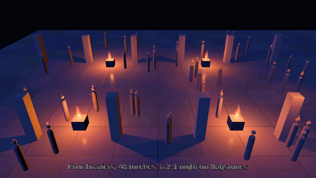

# bevy_lights

Practical lights for Bevy 0.20: fires that flicker and flare as they kindle, a budgeted pool of real
lights placed over thousands of virtual ones, and billboard shader flames.

[](https://github.com/Ladvien/bevy_lights/actions/workflows/ci.yml)

> ⚠️ **Vibe Coded**
>
> This crate was written with heavy LLM assistance, under human direction and review. Every model is
> researched and every default is cited or marked a design default; the code is tested, gated in CI
> and reviewed against captures. It is still code an agent wrote, and you should treat it as such.



## What you get

- **`Flicker` + `Kindle`** (`FlickerPlugin`). Every `PointLight` and `SpotLight` carrying `Flicker` is
  modulated around its base intensity by a summed sine (0.70–1.00 of base, mean 0.85), and a light
  with `Kindle` flares up over 0.6 s instead of switching on. `Kindled { entity }` is the message a
  host hears on the frame a fire catches, for the sound of it. An invisible light is not rewritten
  (nothing is extracted for it) but its kindle still counts.
- **The light pool** (`LightPoolPlugin::<YourFocusMarker>`). A fixed number of real point lights
  (`LightPool::size`, default 16) is handed every frame to the `PoolCandidate`s nearest the one entity
  carrying your focus marker, each light at the candidate's position plus its own world-space offset.
  Everything else is a flame and nothing else. The assignment is deterministic: distance, then
  `Entity`.
- **Shader flames** (`FlamePlugin`). An additive billboard fire (`src/flame.wesl`) is drawn on every
  `FlameSite`, out of one material and one draw per flame, with each fire's phase and height packed
  into its `MeshTag` so two fires never burn in step. One shared clock, written once a frame, on
  `Time<Real>` — a paused world's fires still move.
- **Engine-free maths** (`bevy_lights::model`). `flicker_factor`, `kindle_gain`, `raised_light`,
  `pack_flame_tag` and their inverses, as plain `f32` functions with no `bevy` in them, so a host can
  reuse them in its own systems.

## Quick start

```rust
use bevy::prelude::*;
use bevy_lights::*;

/// The one thing the pool measures distance from: your camera focus, your player, a squad.
#[derive(Component)]
struct MyFocus;

fn main() {
    App::new()
        .add_plugins(DefaultPlugins)
        .add_plugins((
            FlickerPlugin,
            LightPoolPlugin::<MyFocus>::default(),
            FlamePlugin,
        ))
        .add_systems(Startup, setup)
        .run();
}

fn setup(mut commands: Commands) {
    // A brazier: a real light, that flickers, that kindles when you light it.
    commands.spawn((
        PointLight { intensity: 60_000.0, range: 12.0, shadow_maps_enabled: true, ..default() },
        Flicker { base: 60_000.0, phase: 0.0 },
        Kindle::default(),
        FlameSite { height: 0.9, phase: 0.0 },
    ));

    // A torch-bearer: a virtual light, which gets one of the pool's real lights when it is near.
    commands.spawn((
        PoolCandidate { offset: Vec3::Y * 1.8, intensity: 8_000.0 },
        FlameSite { height: 0.35, phase: 1.9 },
        Transform::from_xyz(4.0, 0.0, 2.0),
    ));

    commands.spawn((MyFocus, Transform::default()));
}
```

A light you want to be able to *re-light* is re-inserted with `Kindle::default()`, which writes
`Kindled` again. A fire you want dimmer or brighter changes its `Flicker::base`, never the light's
`intensity`: the crate writes the intensity every frame.

`examples/courtyard.rs` is the full showcase, `examples/bench_lights.rs` the CPU bench.

## Plays well with

This crate owns **practical lights** and nothing else.

| what | whose |
|---|---|
| Sun, moon, sky, exposure, weather, the lightning flash | `bevy_elements` (this crate never meters exposure and never adds a `DirectionalLight`) |
| A gameplay illuminance grid (how lit a tile is, for AI or stealth) | `bevy_light_grid` |
| Trees, forest-fire spread | `bevy_flora` |
| Who lights a lamp, and when | `bevy_society` or the game |
| Flicker, kindle, the pool of real lights, the shader flames, the placement helpers | **this crate** |

A pool light is a light in mid-air with no source of its own: a host styles it (recolour it for the
palette) and usually tags it so its flame is not drawn there — the flame belongs on the torch.

## Built on

| crate | why |
|---|---|
| [`bevy`](https://github.com/bevyengine/bevy) 0.20 | the engine: `PointLight`, `SpotLight`, `Material`, `MeshTag` |
| [`serde`](https://github.com/serde-rs/serde) | optional derives on every public component and resource (`serde` feature) |

## The craft and the science

Every default is researched and cited, or marked a design default. The notes:

| note | what it settles | key sources |
|---|---|---|
| [`docs/research/fire-light.md`](docs/research/fire-light.md) | the flicker's rate and amplitude, the kindle's flare | Sanctuary decisions 0127/0148; Team Fortress 2's illustrative ramp (SIGGRAPH 2007 *Advances*); the fire-physics literature this crate is still missing |
| [`docs/research/light-pool.md`](docs/research/light-pool.md) | the pool's budget, reach, sort and phases | Olsson, Billeter & Assarsson 2012 (clustered shading); Ghost of Tsushima (SIGGRAPH 2021 *Advances*); *Stochastic tile-based lighting* (SIGGRAPH 2025 *Advances*); RTR4's many-light chapter |
| [`docs/research/flame.md`](docs/research/flame.md) | the flame's shape, noise, ramp and packing | Nguyen, *GPU Gems* ch. 6 §6.1; RTR4 §6.3; Sanctuary decision 0228 |
| [`docs/research/corpus.md`](docs/research/corpus.md) | what the home-still library holds for cinematography, photography, CG lighting, game-lighting craft, many-light rendering, fire physics and perception — and what it does not | the live corpus |

## Bevy compatibility

| `bevy_lights` | Bevy |
|---|---|
| 0.1 | 0.20 |

## Documentation

`cargo doc --open`. The crate's own docs are the reference; `AGENTS.md` is the guide for anyone — human
or agent — changing it.

## Contributing

Read `AGENTS.md` (identical to `CLAUDE.md`). The short version: every feature lands with a research
note, every default is cited or marked a design default, `src/model/` stays engine-free, `src/` stays
free of game vocabulary (`tests/leaf.rs` enforces both), and a shader change is checked with
`tools/wesl-check` before any capture.

## License

MIT OR Apache-2.0, at your option.
