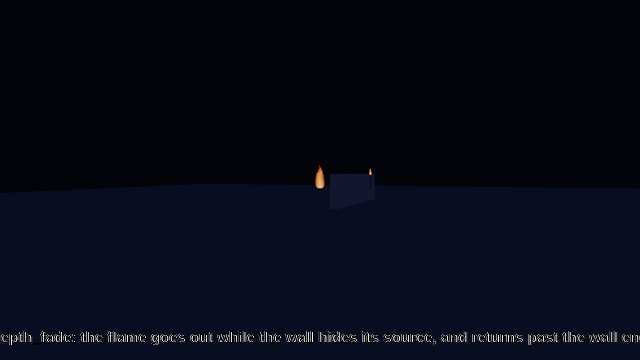
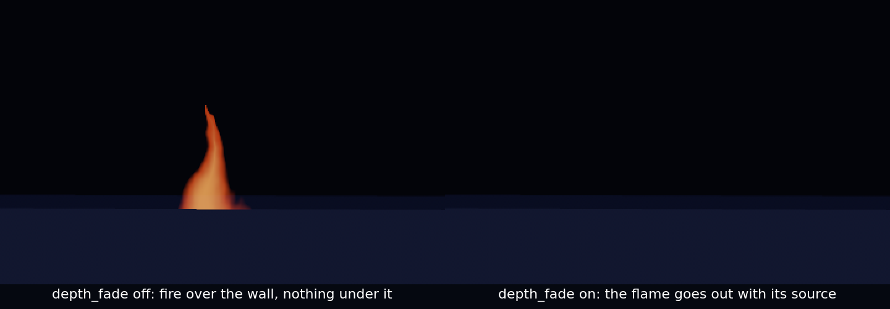
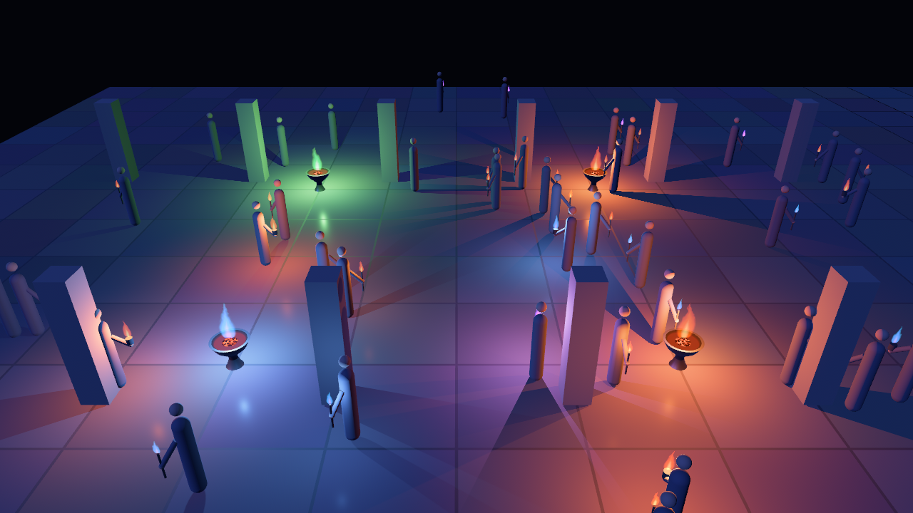
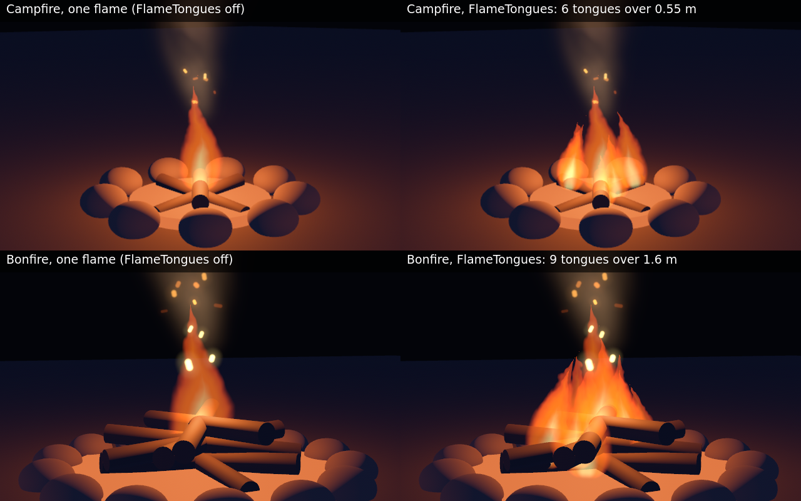
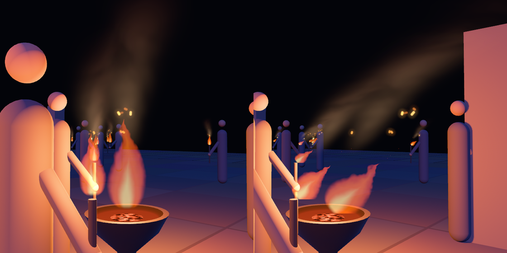
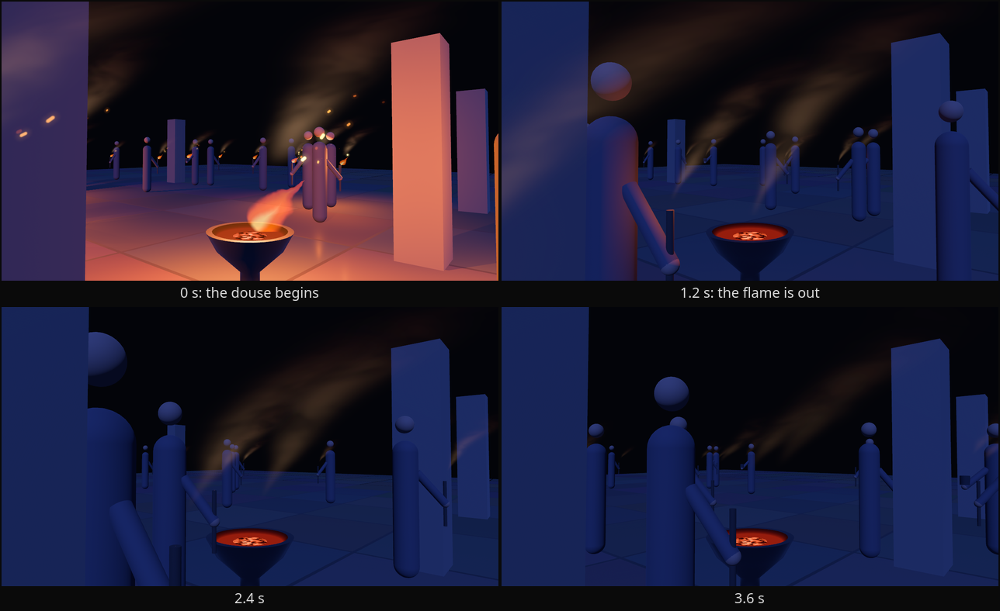
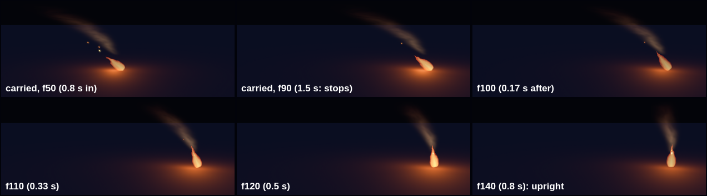

# Shader flames: colour, tongues, sparks, smoke, wind and motion

An additive billboard fire (`src/flame.wesl`) is drawn on every `FlameSite`, out of one material and one
draw per flame, with each fire's phase, height and brightness packed into its `MeshTag` so two fires
never burn in step. One shared shape clock, written once a frame, on `Time<Real>` — a paused world's
shape still moves.

A site with a `kindle` grows its flame from nothing on the same curve its light kindles by, so the two
arrive together. `FlameSite::diameter` given the same value as the light's `Flicker::diameter` makes the
flame **breathe at the light's own rate and phase**, so the fire and the ground it lights are one fire
rather than a still flame over a moving pool; `FlameSite::depth` is the same choice for the flame's
brightness, and giving it the light's `Flicker::depth` is what keeps the two dipping together.
`PoolCandidate::phase` does the same for a light the pool hands over.
`FlameSite::fire: Some(light)` removes the choice: the flame then reads the `diameter`, `depth` and `phase` of that
entity's `Flicker` (or `PoolCandidate`) every frame, so the two cannot be set apart and a `Flicker::set_depth` moves
the flame with it. The light need not be the site's parent; `None` keeps the site's own values.

A flame is taller than its torch, so a torch behind a wall edge can leave a tongue of fire hanging over the
wall with nothing under it. `FlameSite::depth_fade` fades the flame by how much of its source the camera
can see: the shader reads the depth prepass at the flame's source over a disc of taps, so a wall edge
sliding across a torch dims its flame over a few pixels instead of popping it. Give the camera
`DepthPrepass` (without it the flame draws whole); a site that leaves `depth_fade` `false` draws exactly
as before, with no depth read. `cargo run --release --example occlusion` shows both, and
`LIGHTS_DEPTH_FADE=1` runs the same scene faded.

*`examples/occlusion` with `LIGHTS_PAN=1 LIGHTS_DEPTH_FADE=1`, 640 × 360 at 15 fps: the camera swings down the wall's length and back, past the torch whose post the stone hides. Its flame is drawn while any of the source is visible and gone while none is; `depth-fade.png` is the same torch with the fade off, beside it on.*

*`LIGHTS_DEPTH_FADE=0` against `=1` on the same frame of `examples/occlusion`, cropped to the torch: the flame measures a peak of 162 of 255 grey levels in the region above the wall with the fade off and 24 with it on, and nothing above 60 with it on.*

**A fire's own colour.** `FlameSite::color: Option<Color>` gives one fire a colour of its own: a blue gas lantern, a green witch-fire or a violet shrine brazier among orange torches. `None` is the scene's `FlameLook::color`, drawn exactly as before. The colour is the middle of the flame's ramp and the rest is the same flame in that hue, a darker and more saturated rim and a paler core (`retint`, in `bevy_lights::model::fire_colour`); a red, orange or yellow keeps the shipped rim and core, which were tuned for them, so no existing scene changes. The flame's sparks (`FlameEmbers`) follow it. **Give the light the same hue**, so the flame and the ground it lights are one colour (a flame colour above 1 is a brighter fire, and a blue has half the luminance of the scene's orange at the same channel values, so scale a dim hue up on the flame, not on the light): the fire's own `PointLight::color` for a `Flicker`, `PoolCandidate::color` for a prop the pool lights (the pool's light takes it on the frame the light changes owner, while it is fading in from nothing, the light fading out keeps its owner's, and a candidate with no colour gets the template's, or your palette's, back). Every distinct colour is one more material and one more batch, shared by every flame of it and released with the last: a handful is free, and a colour changed every frame is a material a frame. `LIGHTS_COLOURS=1 cargo run --release --example courtyard` is the picture below, [`docs/research/fire-colour.md`](../research/fire-colour.md) the sources.

*`LIGHTS_COLOURS=1` on the courtyard (seed 7, pool 8, 1280 × 720, frame 300): braziers 1 and 2 are a gas-flame blue `(0.10, 0.32, 1.0)` and a witch-fire green `(0.20, 1.0, 0.30)`, braziers 0 and 3 stay the scene's orange, and every fifth torch carries a blue or a violet `(0.62, 0.20, 1.0)`. Each coloured fire has `FlameSite::color` on its flame (the blue ones scaled 1.8 and the violet 1.6 to be as prominent as the orange), the same hue on its light (`PointLight::color` for a brazier, `PoolCandidate::color` for a torch), and the stone round it is lit in that hue.*

*`cargo run --release --example campfire` (1280 × 720, frame 240; each panel a crop, the captions burned in): left, `LIGHTS_TONGUES=0`, the two `FireKind`s drawn as the one flame they were; right, the kinds' own `FlameTongues` (`FireKind::Campfire.tongues()`, `FireKind::Bonfire.tongues()`). Both have their kind's sparks and smoke, which stay one quad each.*

**Tongues.** A flame is one teardrop, `0.4` of its height wide: a candle's and a torch's shape, and the wrong one for a campfire's 0.8 m bed under a 0.7 m flame or a bonfire's 3 m pyre under a 2 m one, which drew one slender tongue in the middle of a heap of fuel. Add `FlameTongues { count, spread }` (`count` up to `MAX_TONGUES`, 9; `spread` the width of the bed, in your units; `FireKind::tongues()` gives a campfire's and a bonfire's, and `None` for the rest) to a `FlameSite` and the site keeps its own flame as the middle tongue and gains `count - 1` more `Flame` children round it, each a `FlameTongue`: shorter the further from the middle it stands, on a clock of its own, and leaning in towards the middle one, so the fire is a mound that parts and rejoins as one fire breathes and converges on a tip. `flame_tongue(index, count, spread, height, seed)` is the layout as a plain function; no tongue stands taller than three times its distance from the middle one, the height at which two flames that far apart are one flame ([`docs/research/flame-tongues.md`](../research/flame-tongues.md)). A tongue is an ordinary flame, so it catches and goes out with its fire, leans in a wind, fades behind a wall edge by the depth fade and is culled by a box of its own; it is one more draw, so a fire that does not ask pays nothing and a campfire is six draws. Changing the component at run time rebuilds the tongues and removing it takes them away.

**Embers.** Add `FlameEmbers { rate }` (sparks a second, `0..=MAX_EMBER_RATE`, default 3) to a `FlameSite` and its flame sheds sparks: short streaks, orange or the fire's own colour, that leave the flame, climb under drag, weave, and cool from yellow through orange to red before they go out (`src/embers.wesl`). It is one extra camera-facing quad per fire, a child of the flame, with no particle state: every spark is a function of the shared clock and an integer hash, so a fire's sparks are the same on every machine and cost one draw. The quad takes the flame's catch and wind lean, so a fire not yet caught sheds nothing, a snuffed one stops, and a wind carries the sparks 1.5 times as far downwind as it leans the flame; `depth_fade` hides the sparks of a hidden source too. A site without the component draws exactly as before. Measured with `LIGHTS_GPU_TIMING=1` on an RTX 3090 (the courtyard's 52 flames, 8 sparks a second each), the transparent pass takes about 11 µs without embers and 107 to 137 µs with them, so the sparks cost about 0.1 ms a frame there. `LIGHTS_EMBERS=3 cargo run --release --example courtyard` shows it; [`docs/research/flame-embers.md`](../research/flame-embers.md) has the sources.

*`LIGHTS_SMOKE=0.8` (the default density) on the courtyard with `LIGHTS_EMBERS=4` (seed 7, pool 8, each panel a 680 × 680 crop of a 1280 × 720 frame at 300 frames): left, still air; right, `LIGHTS_WIND=3,0`. The smoke is lit by the flame and by nothing else, so it is brightest just above the tip and gone into the dark before the top of its quad.*

**Smoke.** Add `FlameSmoke { density }` (`0.0..=MAX_SMOKE_DENSITY`, default 0.8; `FireKind::smoke()` gives each kind its own) to a `FlameSite` and its flame goes on up as a faint plume: a column that leaves the flame's tip, widens the way a turbulent plume does and thins into the dark, whose wisps are lit by the fire (`src/smoke.wesl`). In a `FlameWind` it bends over downwind as a bent-over plume does, so the wind shows from across the courtyard. It is one more camera-facing quad per fire, a child of the flame, with no particle state: the column is a function of the shared clock, so it is the same on every machine and costs one draw, and a fire without the component pays nothing. The quad has the sparks' geometry and carries their culling box, so a fire whose smoke is off the screen draws none of it; it takes the flame's catch (a fire not yet caught smokes nothing; a fire put out leaves a trail, below), `FlameSite::color` (a green fire smokes green-grey) and `depth_fade`. The smoke is **additive**: at night smoke is visible only by the light the fire puts into it, and an additive layer joins no sorting against your other transparent surfaces. It has no dark, occluding half, so it is a night effect; a game that wants daylight smoke draws its own ([`docs/research/flame-smoke.md`](../research/flame-smoke.md) has the sources and why). `LIGHTS_SMOKE=d` turns it on in the courtyard, and `BENCH_SMOKE=1` for `bench_flames`.

*`LIGHTS_SNUFF=2.0 LIGHTS_SMOKE=0.8 LIGHTS_EMBERS=4 LIGHTS_WIND=3,0` on the courtyard (seed 7, pool 8, 1280 × 720, frames 120, 192, 264 and 336 of a 420-frame run, each scaled to 640 × 360; the captions are burned into the file): every brazier and torch is put out at 2.0 s with `Snuff`. The walkers are the example's own and pass in front of the bowl.*

**A put-out fire's trail.** The flame of a fire that gets a `Snuff` goes out over `SNUFF_SECONDS` (1.2 s), and its smoke does not go with it: the smoke already made is carried on up the way the air carries it, the base of the column lifts off the wick and thins as the wick smoulders out, and after `SMOKE_TAIL_SECONDS` (5 s) the trail ends, exactly dark, so nothing pops. It is lit by the dying flame and then by a weak, broad glow from the coals ([`docs/research/flame-smoke-tail.md`](../research/flame-smoke-tail.md): smoke density is advected, so a source switched off leaves what it made travelling on). It follows the light a site's `FlameSite::fire` names, on virtual time (a paused world's trail holds still); a site that names no fire has no douse to follow, a fire loaded as already out begins no trail, and re-lighting a fire ends its trail at once. It is the same quad, so it costs nothing a fire without a douse does not, and a scene that puts nothing out draws what it always drew. `LIGHTS_SNUFF=<seconds>` shows it in the courtyard ([`docs/DEMOS.md`](../DEMOS.md)).

**Wind.** Insert `FlameWind { velocity }` (metres per second on the ground plane; the host copies it from
its weather, which this crate does not own) and every flame leans downwind by the Welker–Sliepcevich
pool-fire tilt for *its own fire's* `diameter`, so a brazier bends less than a torch in the same gust and
every flame in the scene bends the same way. The flame keeps its foot and its length and turns about its
foot (a 3 m/s wind lays a 0.34 m brazier's flame over by about 60°; the lean is capped at 70°), and it is
drawn upright from straight overhead. No `FlameWind` (or a zero one) draws every flame exactly as before.
`flame_tilt(speed, diameter)` is the same law as a plain function. The pool's light for a fire moves with the
lean, to where the leaned flame's middle is (`lean_light_shift`), so a fire built from a `FireKind` (a `Fire`, or its
`site()` and `candidate()`: its light is handed to the flame's middle, not its foot) keeps its key
light in the flame in a wind. `LIGHTS_WIND=x,z cargo run --release --example courtyard` shows it; [`docs/research/flame-wind.md`](../research/flame-wind.md)
has the sources.

**Gusts.** Insert `FlameGust { mean, intensity, timescale, seed }` instead of writing `FlameWind` yourself and `FlamePlugin` writes `FlameWind::velocity` every frame from `gust_velocity`: the mean wind with a stationary Gaussian fluctuation of relative size `intensity` (the turbulence intensity, 0.25 by default) that stays correlated for `timescale` seconds (2 by default), with the heading wandering about `intensity` radians. It is a pure function of `Time<Real>` and the `seed`, so two machines see the same wind and a paused world's fires still sway. The tilt law is steep at a breeze and flat at a gale, so gusts read best at 0.2–0.8 m/s (a flame easing between roughly 20° and 40°); at 3 m/s the flame is already near its cap. `LIGHTS_WIND=0.4,0 LIGHTS_GUST=0.5 cargo run --release --example courtyard` shows it; [`docs/research/flame-gust.md`](../research/flame-gust.md) has the sources and what is a design default.

**A fire that moves.** The air a moving fire meets is the air it moves through, so a torch carried at a walking pace is in a wind of its own: `FlamePlugin` tracks every `FlameSite`'s ground velocity from its `GlobalTransform` (a component, `FlameVelocity`, that a host reads and never writes) and each flame leans on the wind **less that velocity**, by the same `flame_tilt` of the relative speed. A bearer's flame streams behind them (a 0.1 m torch at 1.4 m/s is laid over by about 55°; at a stroll of 0.5 m/s, 40°), more at a jog, with the wind behind them less and into it more, and stands up again over about half a second when they stop; the pooled light stands in the leaned flame and the sparks and smoke stream with it. A fire that stands still is drawn exactly as before, and a lantern swung on a pole sways its flame against the swing with no code of yours. A host sets how much of its own velocity counts with `FlameMotion { gain, response }` (`1.0` is physics; `0.0` is every flame upright however it is carried; `response` is the filter's time constant, 0.15 s, which averages a fixed-step character's uneven frames). A step of more than 40 m/s in a frame is a teleport and carries no velocity. `smooth_velocity` and `relative_air` are the maths as plain functions; `LIGHTS_WALK=1.4 LIGHTS_KIND=torch cargo run --release --example fires` carries one, and [`docs/research/flame-motion.md`](../research/flame-motion.md) has the sources.

*`LIGHTS_KIND=torch LIGHTS_WALK=1.4 LIGHTS_WALK_FOR=1.5` on `examples/fires.rs`, a `Fire::lit(FireKind::Torch, …)` and nothing else, carried along +X for 1.5 s and then still (six 420 px crops of 1280 × 720 frames, captured at a fixed 1/60 s step: frames 50 and 90, the last of the walk, then 100, 110, 120 and 140; the captions are burned into the file): the flame's bright axis is 57° and 50° from vertical in the first two frames (the law says 55°), 20° a third of a second after it stops and under 10° from half a second on, and the smoke and the sparks stream the same way while it moves.*

**A fire off the screen costs almost nothing.** A flame outside every camera's frustum is neither extracted nor drawn, so a town of thousands of `FlameSite`s costs the frame what the dozens in view cost it: `cargo run --release --example bench_flames` (no window, off-screen, a GPU adapter) puts 5 000 torches in the world with about twenty in view and reads 2.2 ms a frame, where drawing every one read 7.8 (20 000: 6.4 against 30.0). The box that does it is the crate's own, because the flame's catch and the wind's lean ride in the transform's scale and a box built once would shrink as a fire catches or leans: `flame_cull_extents` is that box, for a host that draws its own flames with `FlameMaterial`. The sparks of a `FlameEmbers` fire are culled the same way by a wider box that grows with the lean (`ember_cull_extents`): with `BENCH_EMBERS=1` every torch sheds sparks, and 5 000 of them read 4.2 ms a frame where drawing every quad read 11.5 (20 000: 9.2 against 37.2), the renderer counting about twenty quads in view instead of all of them. [`docs/research/flame-culling.md`](../research/flame-culling.md) has the geometry and the measurements. A fire's *light* is the pool's, ranked by distance and never by what the camera sees, so a fire off the screen still lights the screen.
